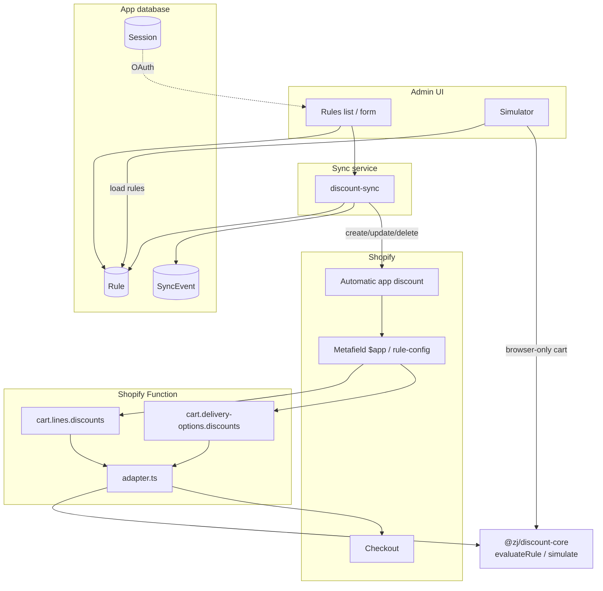

# Architecture

## How the pieces fit

- **Admin → Shopify:** saving a rule writes desired state to Prisma, then one Admin API mutation creates/updates the automatic discount **and** its metafield together.
- **Checkout:** Shopify runs the Function while the discount is active. The Function parses the metafield and calls `evaluateRule`. Dates are **not** checked in the Function (Shopify already gates by `startsAt` / `endsAt`).
- **Simulator:** loads the same rules into the browser, builds a cart in memory, and calls `simulate()` (which uses `isActiveAt` + `evaluateRule` + a labelled combination estimate). Nothing is written to Shopify or the DB.

## Shared discount-core

[`packages/discount-core`](../packages/discount-core) is pure TypeScript: no I/O, integer minor units, no `Date.now()` inside `simulate` (callers pass `now`).

| Consumer | Entry |
|---|---|
| Function | [`extensions/zj-discount-function/src/adapter.ts`](../extensions/zj-discount-function/src/adapter.ts) maps Shopify input → `Cart`, then `evaluateRule`; maps `RuleResult` → operations |
| Simulator | [`app/components/simulator`](../app/components/simulator) builds a `Cart` client-side and calls `simulate()` |
| Admin validation | `validateRule` / form parsing shared by browser and server |

One implementation means checkout maths and simulator per-rule totals stay aligned. The Wasm ⇄ TypeScript parity suite guards Function drift.

**Dual Function targets** (same extension handle `zj-discount-function`):

| Target | Used for |
|---|---|
| `cart.lines.discounts.generate.run` | PRODUCT and ORDER rules |
| `cart.delivery-options.discounts.generate.run` | SHIPPING (free shipping) |

## Data model

From [`prisma/schema.prisma`](../prisma/schema.prisma):

| Model | Role |
|---|---|
| **Rule** | Desired rule state (`config`, dates, `combines*`, `enabled`, `priority`) plus sync bookkeeping (`shopifyDiscountId`, `syncStatus`, `syncedConfig`, `syncedVersion`, `syncError`) |
| **SyncEvent** | Audit of create / update / delete / relink attempts (`ok`, `error`) |
| **Session** | Shopify OAuth sessions (offline tokens; staff name/email usually empty) |

`config` is the desired state. `syncedConfig` is the last snapshot Shopify accepted. They differ only while sync is `PENDING` or `FAILED`.

`syncStatus`: `PENDING` | `SYNCED` | `FAILED` | `DELETING`.

## Sync design

Implemented in [`app/services/discount-sync.server.ts`](../app/services/discount-sync.server.ts).

1. **Atomic write** — One `discountAutomaticAppCreate` / `Update` sends title, dates, `combinesWith`, `discountClasses`, and the `$app` / `rule-config` metafield together. Local row goes `PENDING` → `SYNCED` (stores `syncedConfig`) or `FAILED` (Shopify keeps the previous live version).
2. **Retry** — `retrySync` pushes desired state again. If create succeeded but the ID was never stored, find-by-`ruleId`-in-metafield **relinks** instead of duplicating (`mayHaveOrphan`).
3. **Revert** — `revertToSynced` restores the local row from `syncedConfig` / `syncedVersion` to match what is live on Shopify (no Admin call). Unavailable if never synced.
4. **Reconcile** — On rules-list load, rows stuck in `PENDING` or `DELETING` longer than `STALE_AFTER_MS` (2 minutes) are retried (capped batch).
5. **Disable / enable** — Disable pushes an already-ended discount; enable pushes real dates again (same update path).
6. **Free shipping** — Sync forces `combinesWith.shippingDiscounts` to `false` (Shopify rejects stacking shipping with other shipping).

## Metafield schema versions

Namespace `$app`, key `rule-config`. Writers always write **v5** (`RULE_CONFIG_SCHEMA_VERSION`). Readers accept **v1–v5**.

| Version | Introduced |
|---|---|
| v1 | Amount off products (collection targets) |
| v2 | `TIERED_SPEND` |
| v3 | `BUY_X_GET_Y`; `PRODUCTS` (product-list) targets |
| v4 | `BUNDLE` |
| v5 | `FREE_SHIPPING` |

`minSchemaVersion(config)` rejects payloads that claim an older version than the config type needs (e.g. free shipping cannot live in a v4 payload). Older discounts keep working until next edit, when they are rewritten at v5.

Payload shape (top-level): `schemaVersion`, `ruleId`, `title`, `collectionIds` (for the Function input variable `inAnyCollection`), `config`.
